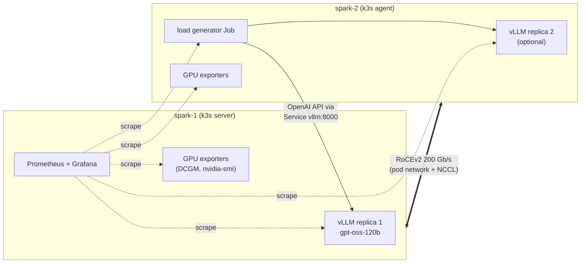

# Desk-Side AI Factory: Serving gpt-oss-120b with vLLM on Kubernetes

**Self-hosted LLM inference on two NVIDIA DGX Spark systems: GPU observability, load testing and
scale-out, end to end.**

A hands-on lab that serves an open-weight 120B-parameter reasoning model on a small two-node
Kubernetes cluster, watches it with Prometheus and Grafana, stresses it with realistic traffic
(spikes, long contexts, shared system prompts), and explains what the numbers mean for
production inference: throughput ceilings, queueing, prefix caching and replica load balancing.

**Hardware:** two NVIDIA DGX Spark systems (GB10 Grace Blackwell Superchip, 128 GB unified CPU/GPU
memory each), connected back to back by one 200 Gb/s ConnectX-7 QSFP cable running RoCEv2, plus a
normal LAN for management.
**Model:** `openai/gpt-oss-120b` (MXFP4), served by vLLM.

Measured results are in [RESULTS.md](RESULTS.md); the write-up is in [docs/article.md](docs/article.md).

---

## What it builds



| Layer | What runs | Why |
|---|---|---|
| Cluster | k3s (server on spark-1, agent on spark-2), flannel VXLAN over the RDMA link | Lightweight Kubernetes; pod traffic uses the fast link |
| GPU | NVIDIA GPU Operator (driver and toolkit come from the OS), time-slicing with 4 slots per GPU | Lets several pods share a GPU; slots are scheduling units, not isolation |
| Telemetry | kube-prometheus-stack, DCGM exporter, an nvidia-smi exporter fallback, recording rules `spark:*`, a Grafana dashboard | GB10 exposes only a few DCGM fields, so the rules prefer DCGM and fall back to nvidia-smi |
| Serving | vLLM (`nvcr.io/nvidia/vllm`), one replica per node, hostPath caches for weights, compile and tokenizer | Each node holds the full model; replicas scale out without sharding |
| PyTorch | GPU burn Job (matmul TFLOP/s, power, clocks) and a two-node `all_reduce` over NCCL/RDMA | Baselines for the GPU and the interconnect |
| Load | `tools/loadgen.py` as a Job: staged profiles (ramp, spike, prefix, kv-pressure, open-loop, soak) | Closed- and open-loop load with per-request records and live metrics |
| Analysis | `tools/analyze.py` joins client records with Prometheus | Per-stage tables, findings, charts; trusts server counters where the client view is skewed |

## How it is organised

Every step is one script, run on spark-1. Each script is idempotent, prints `PASS / WARN / FAIL`
lines, and ends with a one-line summary.

| Step | Script | What it does |
|---|---|---|
| 0 | `00-preflight.sh` | Read-only checks: SSH, sudo, GPU, container runtime, OS parity, link |
| 1 | `01-k3s-install.sh` | Installs k3s on both nodes and proves cross-node pod networking (`netcheck.sh` diagnoses it layer by layer) |
| 2 | `02-monitoring.sh` | Prometheus, Grafana (admin password generated into a Secret), ServiceMonitors, rules, dashboard |
| 3 | `03-gpu-operator.sh` | GPU Operator with time-slicing, DCGM and nvidia-smi exporters, CUDA smoke pod |
| 4 | `04-vllm.sh` | Downloads the model on a node, deploys vLLM, waits through load/compile/graph capture, smoke-tests chat and tool calls; `scale 2` adds a replica on spark-2 |
| 5 | `05-pytorch.sh` | `burn` (GPU stress and telemetry summary) and `allreduce` (NCCL bandwidth between the nodes) |
| 6 | `06-load.sh` | `run <profile>` launches the load Job, pulls results, and warns if more than 1% of requests failed; `bench` runs a `vllm bench serve` sweep |
| 7 | `07-analyze.sh` | Builds the report for a run: server and client tables, GPU/node table, findings, charts |
| - | `ui.sh`, `status.sh`, `teardown.sh` | Port-forwards, one-screen status, clean removal |

All settings (node names, addresses, pinned versions, data directory) live in one file,
`lab.env`, copied from `lab.env.example`. Manifests in `k8s/` are templates rendered from it.

## Quick start

```bash
cp lab.env.example lab.env && $EDITOR lab.env   # node names, management IPs, RDMA interface
./scripts/00-preflight.sh
./scripts/01-k3s-install.sh
./scripts/02-monitoring.sh
./scripts/03-gpu-operator.sh
./scripts/04-vllm.sh                # download + deploy + verify (first start ~10-30 min)
./scripts/05-pytorch.sh burn
./scripts/05-pytorch.sh allreduce
./scripts/06-load.sh list           # available load profiles
./scripts/06-load.sh run ramp
./scripts/07-analyze.sh             # report for the last run
./scripts/04-vllm.sh scale 2        # optional: second replica on spark-2
```

Useful switches:

- `LOADGEN_NO_KEEPALIVE=1 ./scripts/06-load.sh run <profile>` opens a new connection per
  request, so the Kubernetes Service balances per request instead of per connection.
- `VLLM_MAX_NUM_SEQS=128 ./scripts/07-analyze.sh` tells the analyzer the combined scheduler cap
  when two replicas run.

## Design decisions worth knowing

- **Unified memory changes the rules.** On DGX Spark (GB10) the GPU and CPU share one memory pool, and the
  page cache counts as used. vLLM checks free memory at startup against
  `--gpu-memory-utilization`, so `04-vllm.sh` drops the page cache before every deploy.
- **One replica per node, never two on one node.** The Deployment uses `Recreate` and requires
  one pod per node; a 63 GB model cannot be duplicated on one machine during a rollout.
- **Every model node needs the tokenizer vocabulary too.** gpt-oss downloads its Harmony vocab on
  the first request; a node that cannot fetch it passes health checks but fails every request.
  `deploy` copies the cached vocab to every model node.
- **Server counters over client timings at high concurrency.** The client books tokens to the
  stage that sent a request; the server counts what it generated in each window. The analyzer
  reports both and says which to trust.
- **GPU "busy" is not utilisation.** It reads ~96% even at one request. Power draw, compared with
  the burn test, is the better load signal (decode is memory-bound, prefill is compute-bound).

## Repository layout

```
lab.env.example     every setting (nodes, addresses, pinned versions, data dir)
scripts/            one script per step; lib.sh holds shared helpers
k8s/monitoring/     kube-prometheus-stack values, ServiceMonitors, rules, Grafana dashboard
k8s/gpu/            GPU Operator values, nvidia-smi exporter, DCGM field list, CUDA smoke pod
k8s/vllm/           model download Job, vLLM Deployment + Service
k8s/pytorch/        GPU burn Job, two-node all_reduce pods
k8s/load/           loadgen Job, vllm bench sweep Job
tools/              loadgen.py, analyze.py, nvsmi_exporter.py, torch_burn.py, torch_allreduce.py
hack/               make_dashboard.py (generates the Grafana JSON)
tests/              offline harness: fake vLLM, fake nvidia-smi, fake Prometheus
```

## Offline tests

`make lint render e2e` needs no cluster or GPU: shellcheck, Python compile, manifest rendering,
and an end-to-end run of the exporter, load generator and analyzer against fakes. It writes a
synthetic sample report to `tests/artifacts/` to show the format; nothing there is a
measurement. `make validate` also checks manifests against Kubernetes 1.36 schemas and the
Prometheus Operator CRDs (set `KPS_CRDS` to the chart's `charts/crds/crds`).

## Secrets and local data

Nothing secret is stored in the repository. `lab.env`, the generated Grafana password file and
`results/` are git-ignored. Optional tokens (`HF_TOKEN`, `NGC_API_KEY`) are read from `lab.env`
and turned into Kubernetes Secrets at run time.
